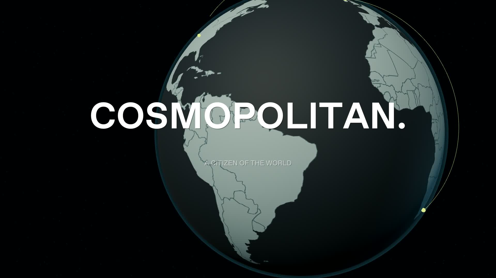
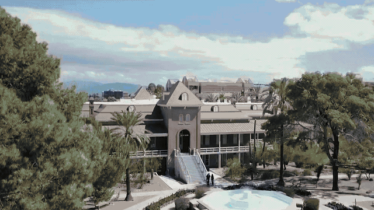
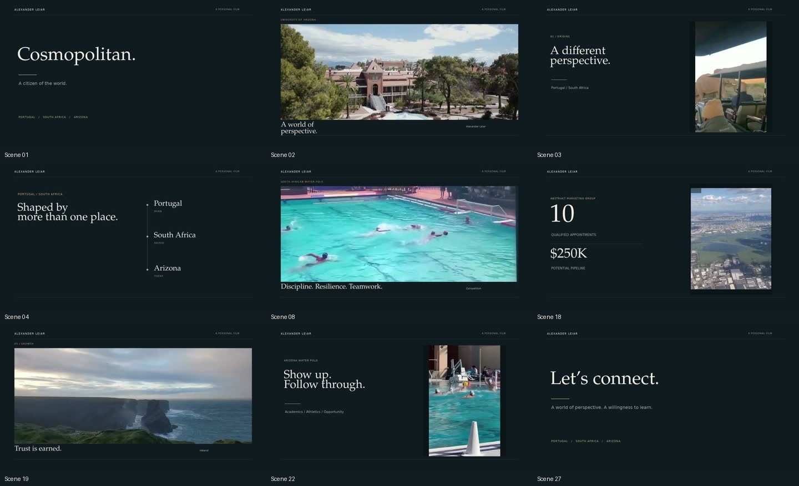

# Alexander Leiar — complete all-new edit

## Full all-new film — 2:55

[**Watch / download the full film**](https://github.com/ahleiar/test/raw/refs/heads/main/Alexander_Leiar_Full_Edit_All_New.mp4)

This is the complete five-act narrated concept film, with new imagery, depth-camera motion, a custom 3D globe, animated figures, original music/sound design and the supplied email/LinkedIn closing card. **No original user footage, photos or original audio are used.**

The voice is a generic synthetic narrator. Most scene imagery is AI-generated and animated; two legacy stock inserts are included. Illustrations are not documentary footage of Alexander. [Sources, production notes and validation](all-new-edit/CREDITS.md) · [Optional captions](all-new-edit/Captions.srt)

## Earlier versions

# Alexander Leiar — current production

## Five-act script revision — current V3

[Watch/download the selected-sequence review](https://github.com/ahleiar/test/raw/refs/heads/main/production-v3/Alexander_Leiar_V3_Sequence_Review.mp4) · [Editable assembly bundle](https://github.com/ahleiar/test/raw/refs/heads/main/production-v3/Alexander_Leiar_V3_Editable_Assembly.zip)

The script now follows Alexander’s five acts. His wildlife, both water polo sources and personal moments are retained. Camera/voice pickups and generic stock replacements are explicitly marked in the editable timeline. This review reel shows selected retained footage, the professional route animation and the contact card; **it is not the full narrative film**.

- [Approved script](production-v3/SCRIPT.md)
- [Recording slots and capture guide](production-v3/RECORDING_GUIDE.md)
- [Picture and stock replacement plan](production-v3/PICTURE_PLAN.md)
- [Project notes and validation](production-v3/README.md)

Closing card: **alexleiar@gmail.com** · [LinkedIn](https://www.linkedin.com/in/alex-leiar-395b1a415/)

Stock sites remain blocked in the current environment. Access domains are saved in the environment draft but not yet active. No stock clips have been downloaded or licensed, and new recordings are still pending.

## Earlier previews and delivery

# Alexander Leiar — video project

## Modern edit — motion preview

[Watch or download the new 14-second preview](https://github.com/ahleiar/test/raw/refs/heads/main/Alexander_Leiar_Modern_Style_Preview.mp4)

This is a style preview combining the redesigned opening and sales-figure sequence, not the finished narrative edit. It uses the supplied footage with edge-to-edge images, quick cuts, moving typography and animated numerical reveals. No stock footage or generative replacement clips have been inserted. The full edit is held for feedback on this direction.

## Earlier delivery

# Alexander Leiar — video deliverables

[Download all deliverables](https://github.com/ahleiar/test/raw/refs/heads/main/Alexander_Leiar_All_Deliverables.zip)

If GitHub displays the ZIP file page, choose **Download raw file**. The bundle is approximately 75 MB.

The bundle includes:

- The full 2:52 editorial review video, in a 1920×1080 composition at 24 fps.
- The editable source project, original supplied footage, rendering scripts and design assets.
- Open Higgsfield replacement-shot prompts and reference frames for a later generation pass.
- A visual preview, optional caption review draft and technical validation report.

This local post-production pass uses the original 720p footage. AI replacements have been prepared but not generated; no provider credits were spent. The planned on-camera sections still require the actual recordings. The caption file is a review draft reconstructed from the visible source captions, not an audio-verified transcript.

All 27 scenes matched their declared frame counts and decoded successfully. The final video has 4,132 frames and passed complete audio/video decoding.
